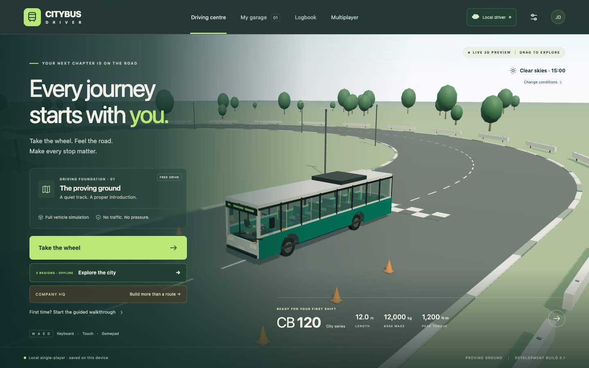
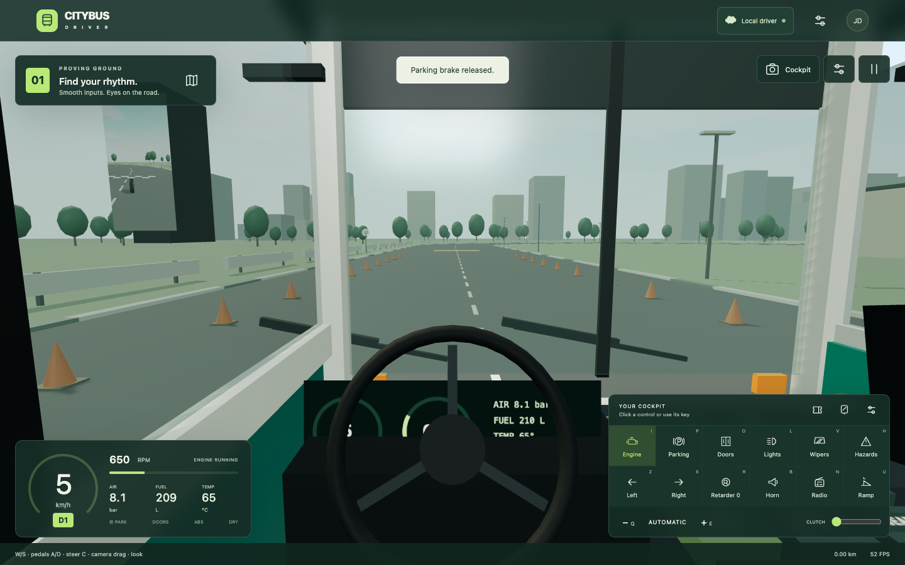
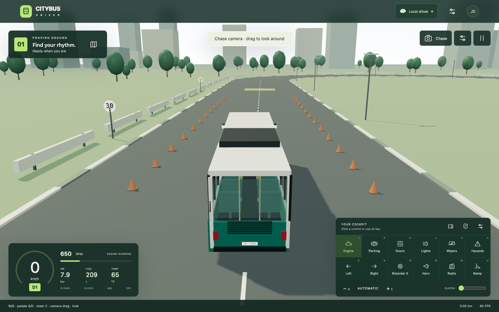
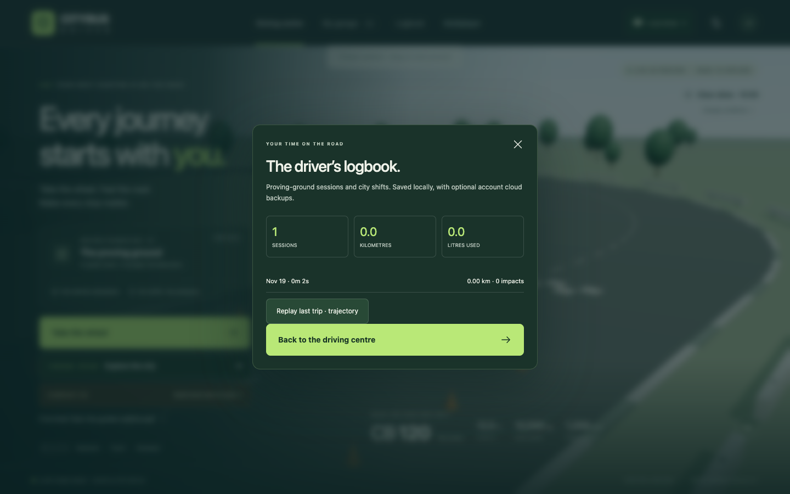
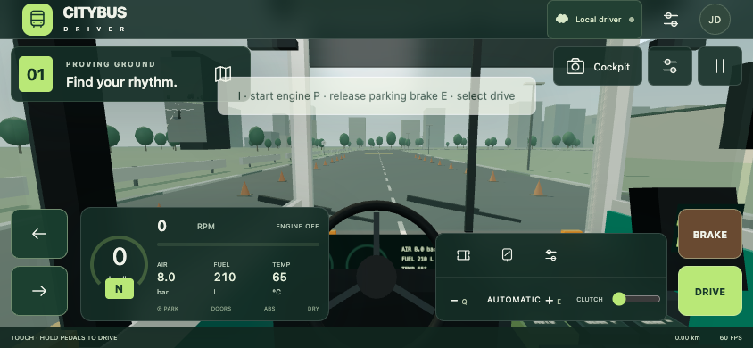
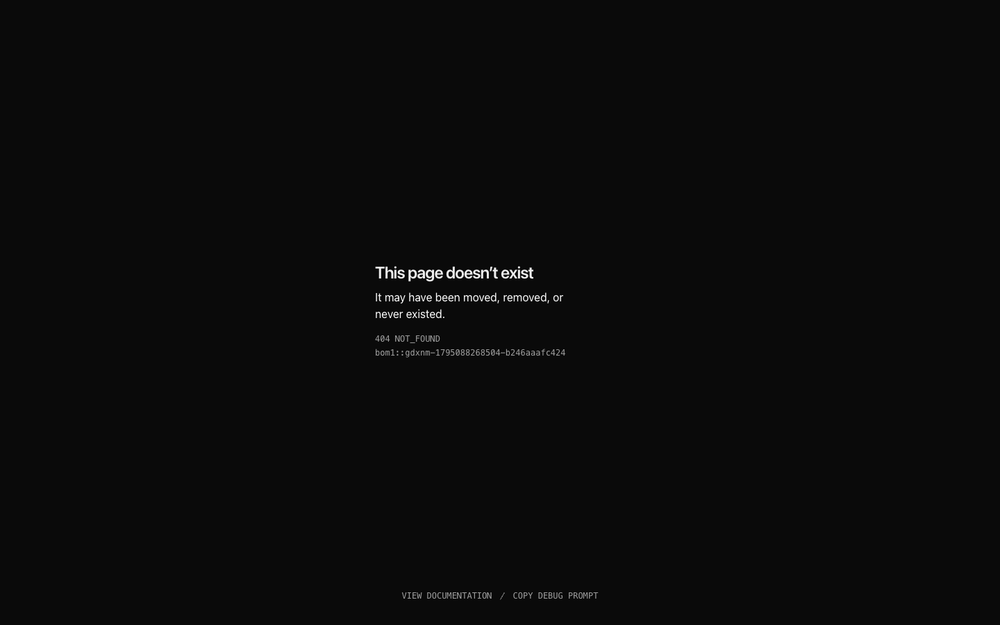
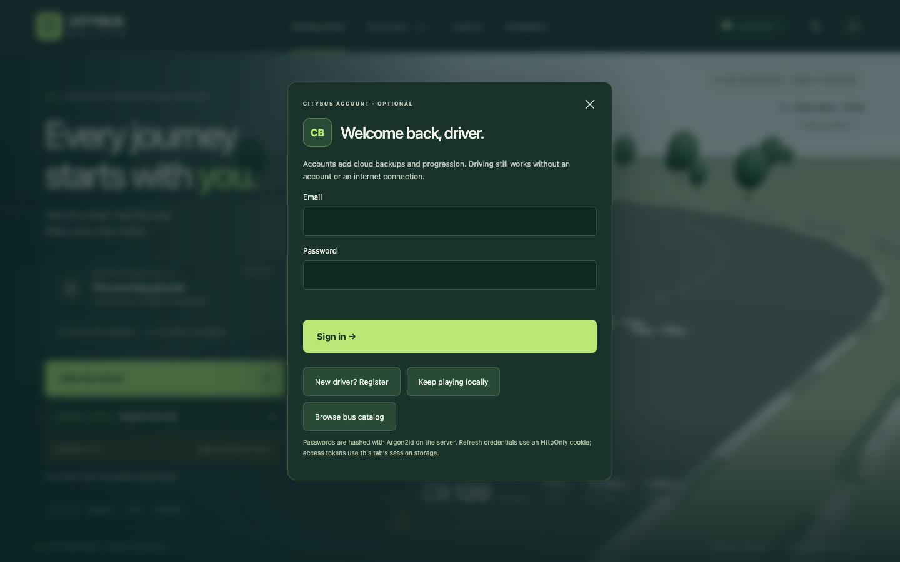
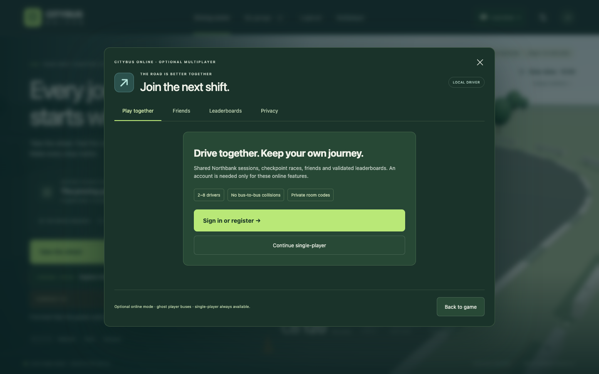

# CityBus Driver — Final Publication Report

## Links

- **GitHub repository:** [https://github.com/DIVYAPRIYADHARSHINI-GIT/citybus-driver](https://github.com/DIVYAPRIYADHARSHINI-GIT/citybus-driver) — public, branch `main`.
- **Live frontend:** [https://citybus-driver.vercel.app](https://citybus-driver.vercel.app) — deployed on **Vercel Hobby**.
- **Live backend:** **not deployed**. Render CLI is not installed; the required Render step was stopped rather than bypassing authentication or creating an account.
- **Backend `/health` address:** **unavailable until Render is provisioned**. No backend hostname or successful health result has been invented.
- **Last full live browser verification:** **19 November 2026, 17:07:51 IST (Asia/Kolkata)**.
- **Free-host notice:** a free Render backend may take up to about a minute, sometimes longer, to wake after being idle. Free PostgreSQL expires after 30 days.
- **Deployment instructions:** [DEPLOY.md](DEPLOY.md). **Printable report:** [FINAL_REPORT.pdf](FINAL_REPORT.pdf).

## Outcome

**GitHub publication and the free frontend deployment are complete. Backend provisioning and live online-feature acceptance are blocked.** The public frontend successfully runs the main menu and an actual single-player drive. Login, cloud save and authenticated multiplayer rooms must not be presented as working live while the API is absent.

No paid plan, Git LFS, payment details or new provider account was used. GitHub and Vercel were already authenticated. The Vercel scope was checked before and after project creation and remained **Hobby**. No Render account, service or database was created by the agent.

## What was published

The repository contains the frontend, backend, STAGE1–STAGE6 notes, README, deployment instructions, free-only Render blueprint, report sources/PDF and screenshot evidence. It is an isolated CityBus project directory; unrelated apps and CAD projects from the original workspace were not published.

- Local Git identity: **Divya Priyadharshini**, `divyapriyadharshini@softage.ai`.
- Branch: **main**. Initial commit: `b03f335` — “Initial CityBus Driver release: frontend, backend, stage notes and preserved evidence”.
- The requested GitHub repository did not exist in the completed owner lookup and was newly created as public.
- Vercel project `citybus-driver` is linked to this GitHub repository, configured for Vite with root directory `frontend`, and was observed in `READY` production state.
- All `.env*` filenames are excluded, including `.env.example`. Safe public templates are named `environment.example`; private `.env` files were not copied or staged.
- The initial staged audit covered 297 files, with zero dotenv files, zero credential-pattern findings and zero files above 50 MB. No paid LFS was used.
- 137 earlier local images were preserved: 128 under `screenshots/local/` and nine failure images under `bugs/local/`. New live evidence is kept separately. No failure screenshot was deleted.

## Live verification results

Target: **https://citybus-driver.vercel.app**. Method: real desktop Chrome/WebGL and normal keyboard input; no teleport, forced-finish or gameplay-state mutator was used.

| Area | Observed result |
| --- | --- |
| Public page and main menu | Passed: successful HTTP response, expected title, WebGL app running. |
| Driving | Passed: keyboard accelerator moved the physical bus; steering changed; service brake stopped it. |
| Local saving | Passed: the completed drive appeared in local storage/logbook. This is not a cloud-save result. |
| Landscape layout | Passed: 844×390 desktop touch emulation had no horizontal overflow; driving targets were visible and at least 44 px. Not a physical Android test. |
| Application/rendering errors | No unhandled application errors or unexpected console/WebGL errors in the exercised journey. |
| Login | **Blocked.** The login UI opened, but no backend exists. No real credentials were entered and authentication was not claimed successful. |
| Cloud save | **Blocked.** The configured frontend `/api/saves` probe returned HTTP 404; no cloud synchronization was verified. |
| Multiplayer room | **Blocked.** The sign-in gate was visible; `/api/multiplayer/rooms` returned HTTP 404. No authenticated room was created. |
| API/health | The frontend `/api/health` probe returned HTTP 404. This is a frontend-path probe, **not** a Render health URL. |

**Ten frontend checks passed; three online flows are blocked.** The three intentional API-probe failures are recorded separately from application/WebGL errors. Raw, non-secret evidence: [live verification JSON](verification/live-2026-11-19T11-37-40-052Z.json).

The Vercel build uses the explicit fallback `VITE_API_BASE_URL=/api`, with `VITE_WS_URL` unset, because there is no legitimate backend URL yet. No guessed `onrender.com` address was configured. After the actual Render host exists, set both public API/WSS URLs and redeploy the frontend.

## Live screenshots — successful frontend journey

### Main menu

**Caption:** The actual public Vercel frontend loaded its main menu and 3D scene.

### Physical driving

**Caption:** The bus accelerated through real keyboard input. The test read diagnostics; it did not set position or velocity.

**Caption:** Exterior view after steering and braking in the live proving ground.

### Local progress and landscape

**Caption:** A completed drive was saved locally. This screenshot does not establish cloud-save success.

**Caption:** Desktop Chrome touch emulation at 844×390. Real Android hardware remains unverified.

## Observed problems and blocked flows

### Backend is not provisioned

**Caption:** Actual HTTP 404 from the frontend’s `/api/health` path. Render has not been deployed. This is a deployment blocker, not an invented database or CORS error.

**Caption:** The login form renders, but successful login/refresh cannot be verified without the API. No account credentials were submitted.

**Caption:** The actual multiplayer entry screen requests sign-in. This is not evidence of a successful live room or live race.

Earlier failure captures remain in `bugs/local/`; their presence does not imply the same failures occurred on the live deployment.

## Verification performed before publication

- Git, `gh` and `vercel` were installed. `gh auth status` and `vercel whoami` succeeded without printing credentials.
- GitHub identity was confirmed as `DIVYAPRIYADHARSHINI-GIT`; all 37 existing Vercel projects in the checked scope were searched, with no earlier CityBus project found.
- **378 frontend tests and the TypeScript/Vite production build passed in the isolated publication copy.**
- **246 backend SQLite tests passed against the publication source**, using an existing local virtual-environment entry point and disposable test state. Temporary test-only credentials were not printed or committed.
- Earlier records include 246 backend checks on local live PostgreSQL, separate-origin HTTPS/WSS verification and 168 isolated physical route/model runs. Those remain **local/historical** results, not Render-hosted evidence.
- A local verification command initially used an incorrect/resolved interpreter path and did not execute the tests. It was corrected to the virtual-environment entry point before the successful 246-test run. No result from the failed invocation was counted as passing.

## Render: exact remaining manual action

The Render CLI is missing. Per the requested stop rule, no alternate credential extraction, account creation or paid provisioning was attempted.

1. Sign into your **existing** account at **https://dashboard.render.com/**.
2. Choose **New + → Blueprint**.
3. Select **DIVYAPRIYADHARSHINI-GIT/citybus-driver**, branch **main**, blueprint path **render.yaml**.
4. Confirm both `citybus-driver-api` and `citybus-driver-db` are explicitly **Free**. If either is paid, Free is unavailable, a card/payment form appears or a Free database already occupies the quota, **stop**. Do not upgrade or delete another database.
5. Confirm `CORS_ORIGINS` is exactly `["https://citybus-driver.vercel.app"]`. The blueprint already contains this public value.
6. Apply the blueprint only after those checks. Render generates the signing secret and wires the database connection internally; do not print or copy either secret into source.
7. Read the actual assigned API hostname, verify its `/health`, then set Vercel Production variables `VITE_API_BASE_URL=https://ACTUAL-HOST/api` and `VITE_WS_URL=wss://ACTUAL-HOST/api/multiplayer/ws`. Redeploy and repeat the online checks.

Full commands and settings are in [DEPLOY.md](DEPLOY.md). The Free start command runs Alembic and seed before Uvicorn, with **one worker**. The blueprint uses conservative demo caps of four rooms, 32 connections and 10 Hz snapshots; capacity on Render Free has not been measured.

## Free-plan disadvantages and limits

- Render Free supports WebSockets, but a service spins down after 15 minutes without inbound HTTP/WebSocket traffic. Waking takes about a minute and can exceed client timeouts.
- The workspace has 750 free instance hours per month, shared with other Free services. Exhaustion suspends services until the next month.
- Free PostgreSQL permits one active Free database per workspace, has 1 GB storage, and expires after 30 days. Export data before expiry; no paid upgrade is authorized. This is not indefinite production persistence.
- Free CPU/RAM and authentication memory costs may constrain concurrent users. Earlier laptop load results do not certify Free-host capacity.
- In-memory room state is lost on sleep/restart/deploy. One process/instance is required; durable PostgreSQL data does not make room actors distributed.
- Cross-site cookie restrictions can break refresh even with `SameSite=None; Secure`. Target-browser behavior remains unverified until Render exists.

Official plan references: [Render Free](https://render.com/docs/free), [Render WebSockets](https://render.com/docs/websocket), [Vercel Hobby](https://vercel.com/docs/plans/hobby). No payment details were entered and no paid upgrade was performed.

## Advantages of the Designer tool observed in this work

- **Integrated implementation workflow:** code, configuration, tests and documentation could be read and edited together.
- **Verification rather than assumption:** shell access allowed authenticated GitHub/Vercel operations, repository/plan checks and repeatable builds/tests, with results checked afterward.
- **Visual inspection:** screenshot and PDF inspection exposed real layout issues in earlier work, including hidden landscape pedals and report-page overflow.
- **Evidence preservation:** live screenshots, actual blocker captures and machine-readable results could be saved with source and compared with earlier local evidence.
- **Focused changes:** a dedicated publication copy avoided exposing unrelated workspace projects while retaining both frontend and backend.

## Designer disadvantages and limits observed

- **External authentication is a boundary:** an installed/logged-in GitHub or Vercel CLI did not imply Render was available. The Render blocker could not be treated as a successful deployment.
- **Paths and working directories require care:** local command invocation had to use the correct virtual-environment entry point; tool availability alone did not guarantee a test ran.
- **Generated artifacts still need review:** first-pass PDF/layout output required inspection and correction; visual quality was not automatic.
- **Verification takes time:** full browser journeys and retries consume real time, and local success does not establish live-host success.
- **Emulation is limited:** desktop touch testing is not actual Android/controller testing; local HTTPS is not a certificate of WAN, provider uptime or third-party-cookie compatibility.

These are observed workflow limitations, not invented platform errors or claims about every Designer installation.

## Advantages and disadvantages of the game architecture

**Advantages:** offline driving survives API outages; the static frontend and persistent API have clear responsibilities; PostgreSQL and versioned/idempotent operations protect committed progress; shared vehicle/route profiles support extension without replacing the foundation.

**Disadvantages:** two hosts add CORS/cookie/configuration complexity; the room actor cannot currently scale across processes; browser storage has quota/origin limits; active-world cloud resume is absent; offline plausibility checks are not cheat-proof; procedural art and simplified physics/NPCs are not a complete commercial simulator.

## Scope of improvement

1. Complete the **free-only** Render blueprint step, verify the real API/health URL, update frontend endpoints and test login/refresh, cloud conflicts and multiplayer on the actual hosts.
2. Plan data export before the Free database expires; do not promise permanent free cloud storage.
3. Test real Android/controllers, longer rendered/network-loss sessions and the full live route/model/weather matrix.
4. Continue the interiors/art, terrain, texture compression, localization and operational/moderation work documented in [STAGE6.md](frontend/docs/STAGE6.md).
5. Treat horizontal room scaling as future architecture work, not a reason to silently add paid workers or services.

## What remains unverified

Render service/database creation, backend health, fresh migrations on Render, live authentication/refresh, cloud synchronization, authenticated rooms/races, free-host memory/cold-start behavior and target-device cookie policies are unverified. Real Android/controller hardware, long WAN endurance and production capacity also remain unverified.

**Final boundary:** the GitHub repository and public single-player frontend are real and verified. The missing backend and its online features are explicitly blocked, not marked complete. All live/failure screenshots shown above were actually captured, and no failure screenshot was deleted.
