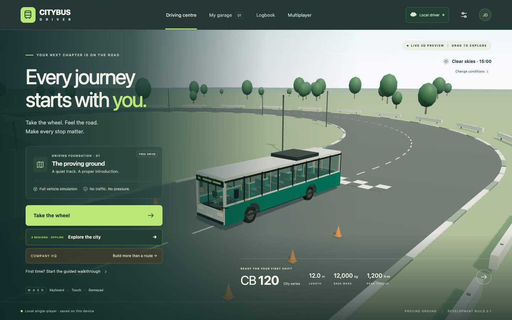

# CityBus Driver

An offline-first bus-driving game prototype with optional company management, cloud saves and multiplayer. Built with Vite, TypeScript, Three.js and cannon-es, with a separate FastAPI / SQLAlchemy / Alembic backend.

## Links and current publication status

- **GitHub:** publication in progress; the requested repository is `DIVYAPRIYADHARSHINI-GIT/citybus-driver`.
- **Live frontend:** deployment in progress.
- **Live backend / health:** not deployed. Render CLI is unavailable; see the exact free-only browser setup in [DEPLOY.md](DEPLOY.md).
- **Last verification:** publication checks started 19 November 2026 (Asia/Kolkata); final live results will be recorded in [FINAL_REPORT.md](FINAL_REPORT.md).
- **Free-host warning:** a free Render backend may take up to about a minute to wake after being idle. Free PostgreSQL expires after 30 days; this is a free demo, not guaranteed permanent hosting.

> The frontend can drive without an API. Login, cloud saving and multiplayer require a working backend and must not be presented as live-verified before one exists.

## Features

- Proving ground, Northbank City, Meridian Metropolis and Coastway Intercity.
- 24 fictional, drive-ready vehicle profiles with automatic/manual drivetrains, electric and articulated variants, suspension, grip, braking and speed-sensitive steering.
- Cockpit controls, keyboard/mouse/touch/gamepad driving, garage, tutorial, day/night and weather presets.
- Traffic, pedestrians, bus stops, passenger queues/tickets, route scoring, GPS, fuel/toll interactions and minimaps.
- Local saves and offline installation, trajectory replay and photo PNG export.
- Optional account/cloud layer, versioned save conflicts and durable upload queues.
- Company fleet/drivers/routes/loans/events with deterministic integer-money settlement and a 24-hour catch-up cap.
- Friends/chat, ghost-bus rooms, checkpoint races, leaderboards and idempotent rewards.

This remains a procedural game prototype, **not** a manufacturer-calibrated driving trainer or a fully polished commercial simulator. Art, simulation, controller, device and production-service limits are documented in [STAGE6.md](frontend/docs/STAGE6.md).



## Architecture

```text
Browser / Vercel static frontend
  ├─ local driving, rendering and browser saves (offline)
  ├─ HTTPS REST → persistent FastAPI service
  └─ WSS room connection → the same single API process
                               └─ PostgreSQL durable data
```

The API must run as **one worker / one instance**. Room state lives in process memory; restarts end rooms, while committed account/company/save/reward data remains in PostgreSQL.

## Run locally

### Backend (optional for guest driving)

```sh
cd backend
python3.11 -m venv .venv
.venv/bin/python -m pip install -r requirements.lock
.venv/bin/python -m pip install --no-deps -e .
cp environment.example .env  # only if no existing .env; never commit it
.venv/bin/python -m alembic upgrade head
.venv/bin/python -m app.seed
.venv/bin/python -m uvicorn app.main:app --host 127.0.0.1 --port 8000 --workers 1
```

### Frontend

```sh
cd frontend
npm ci
npm run dev
# Production/offline build:
npm run build
npm run preview -- --port 4173
```

Open `http://127.0.0.1:4173/` for the production preview. Local defaults proxy `/api` and WebSockets to port 8000. Public production variables are `VITE_API_BASE_URL` and `VITE_WS_URL`; private database/signing credentials belong only in the backend host's managed secret environment.

All `.env*` files, **including example filenames**, are excluded from Git for this publication. Non-secret templates are published as `frontend/environment.example` and `backend/environment.example`. Older stage notes may refer to the original `.env.example` filename.

## Tests

```sh
# frontend/
npm test
npm run build
npm run test:e2e:all          # production preview required; owns isolated test APIs
npm run test:e2e:deployment  # separate local HTTPS origins; requires Chrome + openssl
npm run test:route-matrix
npm run test:endurance

# backend/
.venv/bin/python -m pytest
.venv/bin/python scripts/test_postgres.py  # disposable LOCAL PostgreSQL database only
```

Earlier recorded verification: 378 frontend checks; 246 backend checks on SQLite and the same suite on live PostgreSQL; 168 isolated route/model physics runs. Those are **local** results, not proof of hosted Android/WAN behavior. See the stage notes and final report for methods, failures and coverage boundaries. Never point test fixtures at live player storage.

## Documentation and evidence

- [Free-only deployment steps and manual Render blocker](DEPLOY.md)
- [Final report](FINAL_REPORT.md)
- Stage notes: [1](frontend/docs/STAGE1.md), [2](frontend/docs/STAGE2.md), [3](frontend/docs/STAGE3.md), [4](frontend/docs/STAGE4.md), [5](frontend/docs/STAGE5.md), [6](frontend/docs/STAGE6.md)
- Earlier local screenshots: `screenshots/local/`
- Preserved local failure screenshots: `bugs/local/`
- Live screenshots and problems will be kept separately under `screenshots/live/` and `bugs/live/`; failures are not deleted.

This repository is an isolated publication copy of CityBus Driver. Unrelated applications and maker projects from the original workspace were deliberately not included. No paid service or Git LFS is required.
